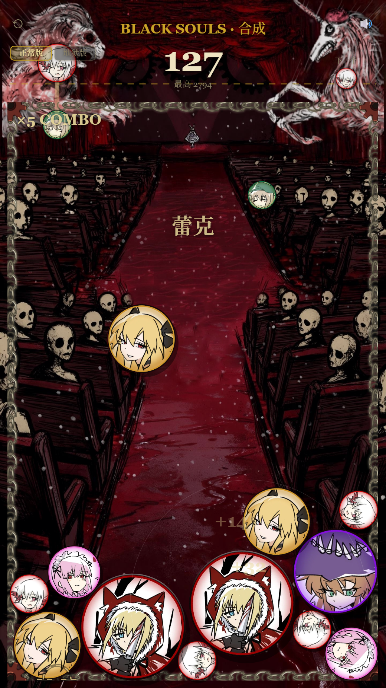

# 合成爱丽丝

**🎮 在线试玩：<https://lord-of-darkness-114.github.io/Hecheng-alice/>**

一个《合成大西瓜》玩法的 BLACK SOULS 同人游戏。**当前是网页版**，共享核心已经按双端
设计好，微信端以后只需要补一个适配层。



> 8 个角色的球体贴图、角色名、各自的合成音效（含投放音）都已接入，还有 **17 条成就**；
> 内置回归测试 **61/61** 通过，**线上部署的那版也实测通过同一套测试**。

## 怎么跑起来

```bash
python tools/serve.py          # 默认 http://127.0.0.1:8080
```
然后浏览器打开 <http://127.0.0.1:8080/web/>

> 不要直接双击 `web/index.html`。浏览器对 `file://` 下的多文件加载、音频、
> localStorage 有限制，跑本地服务最省事。服务器是零依赖的 Python 脚本。

## 操作

| 操作 | 说明 |
| --- | --- |
| 点「开始游戏」 | 从**开始界面**进入游戏（随后 0.5 秒起 BGM） |
| 点「返回」 | 游戏内**右上角**，回到开始界面 |
| 拖动 + 松手 | 移动持球位置并投放 |
| 空格 / 回车 | 投放（键盘） |
| ← → | 微调位置 |
| R | 重开 |
| M | 静音 |
| P | 暂停 |

> 开始界面左边还能切「正常版 / 地狱版」——**这个选择同时决定放哪首 BGM**。
> 开始界面的版式（按钮大小/位置、标题、BGM 延迟）都在 `shared/config.js` 的 `G.TITLE`。
>
> 「开始游戏」用的是**草书网页字体**（柳建毛草 / Liu Jian Mao Cao，OFL 协议）。
> 完整字体 4.7MB 存在 `backup/fonts/`，网页只用裁剪子集 `web/assets/fonts/bs-label.ttf`（**7.5KB**，
> 仅含需要的 11 个字）。**改按钮文字必须重新裁剪字体**，步骤见 `交接文档.md`。

## 目录结构

```
shared/          两端共用的核心（纯 JS，无构建工具）
  config.js        所有玩法数值、美术路径、角色表 —— 改数值只改这里
  audio.js         音频调度（不依赖具体平台，播放能力由适配层注入）
  render.js        画布绘制 + 特效（背景/场地/球/持球/HUD/结算）
  physics.js       Matter.js 封装：建场、球体、固定步长、穿透修正、兜底
  game.js          状态机、投放、合成、计分、连击、失败判定、自测
vendor/matter.min.js   物理引擎（82 KB）
web/             网页壳
  index.html       页面
  adapter-web.js   适配层：画布尺寸 / 指针事件 / 帧驱动 / 存档 / 震动
  audio-web.js     WebAudio 音频实现（合成音 + 音频文件两种模式）
  main.js          入口：加载素材 → 组装 → 启动
  assets/          贴图与音频（贴图待补，音频为占位）
tools/           开发工具（生成音效、本地服务、自动化测试、截图）
docs/            方案文档
```

**"一套核心两个壳"的边界在哪里**：适配层只需要提供画布尺寸、2D 上下文、
指针事件、帧驱动、存档/震动。核心完全不碰 DOM 和 `wx` API，连 UI 都画在
canvas 上，所以微信端不用重写界面。

## 换美术资源

1. 把 8 张球体贴图放到 `web/assets/tiers/tier1.png` … `tier8.png`（透明 PNG/WebP，512×512）
2. 背景图放 `web/assets/bg.png`
3. 改角色名：`shared/config.js` 里的 `G.THEME.tiers[].name`
4. 换音频：覆盖 `web/assets/audio/` 下的同名文件

贴图缺失不会报错——每个版本先找自己的目录，找不到就**回退到默认那套 `assets/tiers/`**
（所以"地狱版"目录空着时，看到的就是和正常版一样的共用贴图）；
连默认那套也没有，才用代码画的渐变球兜底。

## 物理与手感

调参集中在 `shared/config.js` 的 `G.PHYSICS`。已经处理掉的坑：

| 问题 | 解法 |
| --- | --- |
| 高刷屏动画一顿一顿 | 固定步长 60Hz + **渲染插值**（`interpolate`） |
| 球堆抖动、停不下来 | 静止球休眠 + 高摩擦 + 低弹性 + slop |
| 球互相嵌入（视觉穿透） | 位置迭代 10 次 + **几何分离修正**（`sepPasses`） |
| 快速落球穿过地板/墙 | 墙厚 80px（远大于单帧最大位移）+ 速度上限 `maxSpeed` |
| 球堆挤压把球挤出场外 | 分离修正带边界校验；再加 `contain` 兜底拉回 |
| 合成瞬间突兀 | 出场缩放 + 冲击环 + 粒子 + 飘分 + 屏幕震动 + 音效 |
| 持球遮住球堆 | 持球画在球堆**下层**（球堆压得住它），瞄准线与落点指示留在最上层 |

### 持球（预览球）的图层安排

这是个容易被忽略但很影响观感的地方，绘制顺序是刻意排的：

```
背景 → 场地 → 持球 + 出生点虚线圈 → 球堆 → 瞄准线 + 落点指示 → 特效 → HUD → 结算
                    ↑ 球堆画在它上面              ↑ 永远在最上层
```

持球由 `G.LAYOUT.previewTangentGap` 控制（默认 3px）：**球的最低点与警戒线相切**，
再往上留 3px 缝。球心因此是 `警戒线 - 3 - 半径`，球越大球心越高，始终完整待在虚线上方。
物理球的出生点仍是 `dropOffset`。

瞄准提示只有两个（都在球堆上层，所以永远不会被挡住）：

1. **瞄准光柱**——从持球下方起、只画在场内部分，向下渐隐约两倍半径
2. **地面落点标记**——虚线圈 + 两侧短横线，带一层暗底，压在浅色球上也看得清

（持球会升到 HUD 区域，所以标题/分数加了描边阴影，任何情况下都读得清。）

## 自动化测试

```bash
python tools/serve.py                    # 先起服务
# 无头跑内置回归测试（15 项：合成、计分、存盘、穿墙、穿透量、稳定性、失败判定…）
chrome --headless=new --enable-logging=stderr --v=0 --virtual-time-budget=30000 \
       --dump-dom "http://127.0.0.1:8080/web/?selftest=1&headless=1" > NUL 2> log.txt
python tools/parse_console.py log.txt SELFTEST CHECK
```

其他调试开关（拼在 URL 后面）：

| 参数 | 作用 |
| --- | --- |
| `?selftest=1` | 跑回归测试 |
| `?headless=1` | 不初始化音频，适合无人值守 |
| `?debug=1` | 每 500ms 把球数/分数/穿透量写进隐藏 DOM（`tools/parse_dom.py` 可读） |
| `?auto=1` | 自动投放，无人值守压测 |
| `?pile=N` | 在场地顶部正中摆一颗 N 阶球并钉住，用来验证图层遮挡（正常游玩很难堆到顶） |
| `?mute=1` | 静音 |

> `?auto` / `?pile` / `?showtier` 会**自动跳过开始界面**（直接进游戏），
> 否则这几个调试参数会停在标题画面上、什么都测不到。

**注意**：无头 Chrome 的 `--virtual-time-budget` 会把 `performance.now()` 冻住、
`requestAnimationFrame` 不按正常节奏派发，所以它适合跑逻辑回归，**不适合截图或测帧率**。
要截图请在真实时钟下用 CDP：

```bash
python tools/shot.py "http://127.0.0.1:8080/web/?headless=1&auto=1" shot.png 12 520 924
```

## 音频

**背景音乐（BGM）是真实文件**，按命名版本各一首，配置在 `shared/config.js` 的 `G.ASSETS.audio.bgm`：

| 版本 | 文件 |
| --- | --- |
| 正常版 | `web/assets/audio/bgm_normal.mp3`（真 MP3，192kbps） |
| 地狱版 | `web/assets/audio/bgm_hell.mp3`（真 MP3，192kbps） |

音效里已经换成原作素材的两个：
**合成出爱丽丝** = `merge7.mp3`（原作 ME《Fanfare3》）· **失败** = `gameover.mp3`（原作《主人公死ぬ》）。
⚠️ 注意合成音效的**下标差一位**（合成出第 N 阶 → 下标 N-2），改前先看 `交接文档.md`。

> ⚠️ `.ogg` 在 **iOS Safari 和微信 iOS 上放不出来**。代码会自动探测（`canPlayType`），
> 放不出就**没有声音**（合成兜底已按用户要求删除）。
> 要兼容就转成真 `.mp3`/`.m4a` —— **注意别被"改名的 ogg"骗了，要验文件头**
> （真 MP3 = `ID3` 或 `FF Fx`；`OggS` = 还是 ogg），详见 `交接文档.md`。

`web/assets/audio/*.wav` 这些**音效**是 `tools/gen_audio.py` **用振荡器和噪声合成**出来的占位音，
原创无版权问题，可以直接替换或删除：

```bash
python tools/gen_audio.py      # 重新生成
```

网页版即使没有这些音效文件也有声音——`audio-web.js` 会实时合成同样的音色
（**只有音效有合成兜底；BGM 已经改成纯文件，没有合成了**）。

## 微信端（尚未开始）

共享核心已按微信端需要的方式组织：ES5 语法、不用 `import/export`、不碰 DOM。
后续只需要一个 `wxgame/adapter-wx.js` + `adapter-wx-audio.js`（用
`wx.createInnerAudioContext`，`shared/audio.js` 里已经预留好 `Sound.WxImpl`）。
详见 `docs/方案.md` 第 6 节。
